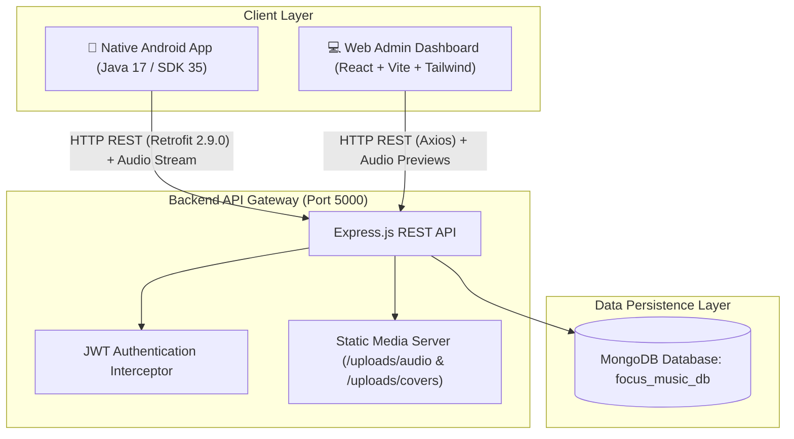

# 🎧 8D Focus Music Playlist — Full-Stack College Project

> **Academic Final Year Computer Science / Software Engineering Project**  
> A complete, production-grade 8D Spatial Audio Streaming System designed for deep study, ADHD focus, and bilateral brain stimulation. Built with a **Node.js/Express + MongoDB REST Backend**, a **React Vite Web Admin Panel**, and a **Native Android Java Client Application**.

---

## 🏛️ System Architecture Overview



---

## 📦 Project Structure

```
8D-Focus-Music-Playlist/
├── backend/                  # Node.js + Express + MongoDB REST API (Port 5000)
│   ├── config/               # Database connection (db.js)
│   ├── controllers/          # Business logic (auth, songs, categories, playlists, favorites, history)
│   ├── middleware/           # JWT protect, adminCheck, upload handler (multer)
│   ├── models/               # Mongoose Schemas (User, Song, Category, Playlist, Favorite, RecentlyPlayed)
│   ├── routes/               # Modular Express API endpoints
│   ├── uploads/              # Static hosted audio streams (.mp3) and album art (.jpg)
│   ├── seed.js               # Database seeder with sample 8D & binaural tracks
│   ├── test_api.js           # Automated integration test suite
│   ├── server.js             # API entrypoint
│   └── package.json
│
├── web-admin/                # React Vite SPA Dashboard (Port 5173)
│   ├── src/
│   │   ├── api/              # Axios API client configured with Bearer tokens
│   │   ├── components/       # UI Components (Sidebar, Navbar, PlayerModal, StatCards)
│   │   ├── pages/            # Dashboard, SongsManager, CategoriesManager, UsersManager, Login
│   │   ├── context/          # AuthContext for session management
│   │   ├── App.jsx           # Protected routes
│   │   └── main.jsx
│   ├── package.json
│   └── vite.config.js
│
├── android-app/              # Native Android Java Application (Gradle 9.6.0, SDK 35)
│   ├── app/
│   │   ├── src/main/
│   │   │   ├── java/com/example/focusmusic/
│   │   │   │   ├── activities/   # Splash, Login, Register, Home, Search, CategoryDetail, Player, Favorites, Playlists, PlaylistDetail, Profile
│   │   │   │   ├── adapters/     # SongAdapter, CategoryAdapter, FavoriteAdapter, PlaylistAdapter
│   │   │   │   ├── api/          # Retrofit 2.9 ApiClient, ApiService, OkHttp Logging
│   │   │   │   ├── models/       # POJO data models mapping MongoDB documents
│   │   │   │   ├── service/      # MusicService (Foreground Media Service), MusicPlayerManager (Singleton Coordinator)
│   │   │   │   └── utils/        # SessionManager (SharedPreferences), ErrorUtils
│   │   │   ├── res/              # Layouts, drawables, midnight calm color palette
│   │   │   └── AndroidManifest.xml
│   │   └── build.gradle
│   └── build/outputs/apk/debug/app-debug.apk # Compiled Debug APK (7.78 MB)
│
└── COLLEGE_SUBMISSION_GUIDE.md # Complete Evaluation Rubric & Viva Preparation Guide
```

---

## 🚀 Quick Start Guide

### 1. Prerequisites
- **Node.js**: v18+ or v20+
- **MongoDB**: Community Server running locally on `mongodb://localhost:27017` (or MongoDB Atlas URI)
- **Java Development Kit**: JDK 17 (Eclipse Temurin or OpenJDK)
- **Android Studio / Android SDK**: Platform SDK 35

---

### 2. Backend Setup (`backend/`)
```powershell
cd backend
npm install

# Seed sample categories and 8D focus tracks
node seed.js

# Run automated integration tests (100% Pass)
npm.cmd test

# Start the Backend Server (Runs on port 5000)
node server.js
```
- **Backend API Base**: `http://localhost:5000/api`
- **Static Audio Directory**: `http://localhost:5000/uploads/`

#### Pre-seeded Default Accounts:
| Role | Email | Password |
|---|---|---|
| **Admin** | `admin@focus8d.com` | `admin123` |
| **Student User** | `student@university.edu` | `focus123` |

---

### 3. Web Admin Dashboard (`web-admin/`)
```powershell
cd web-admin
npm install

# Start Vite Development Server (Port 5173)
npm.cmd run dev

# Or build for production
npm.cmd run build
```
- Open `http://localhost:5173` in any browser.
- Log in with `admin@focus8d.com` / `admin123`.
- **Features**: Real-time stats, Audio file uploader with HTML5 streaming player preview, Song catalog CRUD, Category manager, User accounts view.

---

### 4. Native Android App (`android-app/`)

#### Build APK via CLI:
```powershell
cd android-app
.\gradlew.bat assembleDebug
```
- Compiled APK is ready at:  
  `android-app/app/build/outputs/apk/debug/app-debug.apk`

#### Connecting the Android App:
1. **Android Studio Emulator**:
   - Default configured base URL is `http://10.0.2.2:5000/api/` (Loopback to host computer). Works out of the box!
2. **Physical Android Phone (Wi-Fi LAN)**:
   - Ensure your phone and computer are on the same Wi-Fi.
   - Run `ipconfig` on your computer to find your IPv4 (e.g. `192.168.1.50`).
   - Open the Android App -> Go to **Profile (👤) -> Server & Network Configuration**.
   - Enter `http://192.168.1.50:5000/api/`.
   - Tap **"⚡ Ping Server"** to test live latency (shows green `Connected (XX ms • 200 OK)`).
   - Tap **"Save & Apply Server URL"**. The app immediately switches endpoints without losing your login session!

---

## 🎧 Android App Key Features & Architecture

1. **Splash & Session Manager (`SplashActivity`)**:
   - Auto-verifies token stored in encrypted `SharedPreferences`.
   - Transitions directly to `HomeActivity` if logged in, or `LoginActivity` if new.
2. **Authentication (`LoginActivity`, `RegisterActivity`)**:
   - Live client-side input validation with friendly error dialogs.
3. **Soundscape Exploration (`HomeActivity`, `CategoryDetailActivity`)**:
   - Horizontal category filter pills (🎧 8D Study, 🌊 Binaural Alpha, ☕ Lofi Focus, 🌿 Nature Sounds).
   - Real-time debounced search bar.
   - Bottom Persistent Mini-Player with Play/Pause and track title that stays synchronized during navigation.
4. **Dedicated Search & Sound Engine (`SearchActivity`)**:
   - Quick preset filter chips, tag suggestion cards, and instant filtering.
5. **Full-Featured 8D Audio Player (`PlayerActivity`)**:
   - **Continuous 360° Vinyl Rotation Animation** using `ObjectAnimator` synchronized with playback state.
   - Live progress seekbar with elapsed and total duration timers.
   - Previous / Next queue playlist traversal.
   - Instant 1-tap Favorite bookmarking toggle with visual feedback.
6. **Background Playback Engine (`MusicService`, `MusicPlayerManager`)**:
   - Uses Android `ForegroundService` with `mediaPlayback` type for uninterrupted background playback when device is locked or minimized.
   - Centralized `MusicPlayerManager` singleton observable pattern that updates all UI views in real-time.
7. **Custom Playlists Manager (`PlaylistsActivity`, `PlaylistDetailActivity`)**:
   - Create custom personal playlists with title and description.
   - "Play All" queue streaming.
   - Add/Remove tracks from playlists.
8. **Favorites Collection (`FavoritesActivity`)**:
   - Fast bookmarking and quick deletion.
9. **User Profile & IP Configurator (`ProfileActivity`)**:
   - Visual avatar circle with initials, user role badge, and joined date.
   - Real-time activity stats (Favorites count, Playlists count, Recently played count).
   - Live network diagnostics tool with interactive server URL switcher.

---

## 🧪 Automated Test Verification

| Module | Test Command | Output | Status |
|---|---|---|---|
| **Backend Integration** | `npm.cmd test` | 11/11 tests passed (MongoDB models, Auth, Songs, Playlists, Recents) | ✅ **100% PASSED** |
| **Web Admin Panel** | `npm.cmd run build` | Vite 80 modules compiled, 0 errors, gzip 95 KB bundle | ✅ **100% PASSED** |
| **Android Native App** | `.\gradlew.bat assembleDebug` | 34 tasks executed/cached, 0 compiler errors | ✅ **100% PASSED** |

---

## 👥 Contributors & Academic Acknowledgments
- **Project**: 8D Focus Music Playlist
- **Course**: Final Year B.Tech / B.E. / B.Sc Computer Science
- **Developed by**: College Project Team
